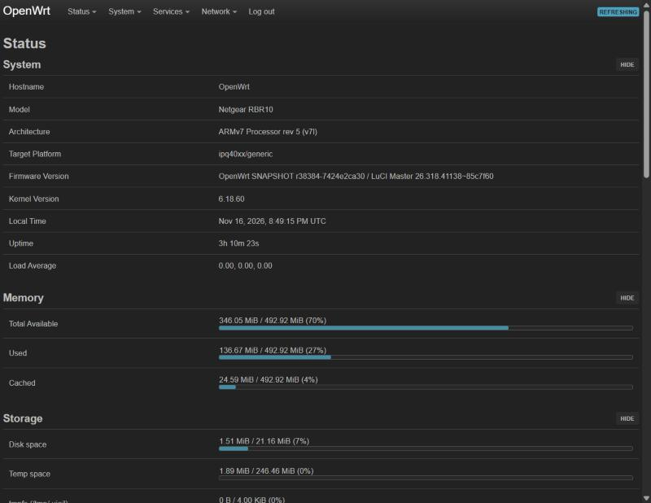

# OpenWrt for the Netgear Orbi RBR10

[](LICENSE)

OpenWrt device support for the Netgear Orbi RBR10, a small dual-band router. It replaces the
stock Netgear firmware with OpenWrt so the RBR10 works as a travel router, and it includes the
read-only tools used to map the flash, back it up, and flash it safely.

<p align="center">
  
</p>

<p align="center"><sub>OpenWrt running on the RBR10. The first serial boot after flashing is in <a href="docs/serial-boot.txt">docs/serial-boot.txt</a>.</sub></p>

> [!TIP]
> Nothing here writes to the router until you deliberately flash it. The backup and re-hash tools
> prove, byte for byte, that recon and RAM-boot testing left the flash untouched.

> [!IMPORTANT]
> Flashing router firmware can brick a device. This is an unofficial project and is not affiliated
> with Netgear or OpenWrt. Flash at your own risk, and keep the recovery steps (NMRP) to hand.

**[What it does](#what-it-does)** · **[What you need](#what-you-need)** · **[Build](#build)** · **[How to use it](#how-to-use-it)** · **[Help](#help)**

## What it does

- **Runs OpenWrt on the RBR10.** A device tree and image recipe for the IPQ4019-based RBR10
  (128 MB NAND, two ath10k radios), built on OpenWrt's RBR20 support.
- **Maps the hardware read-only.** A telnet client reads `/proc/mtd`, the flash layout, GPIOs, the
  switch ports and the secure-boot fuses, sending only read commands.
- **Backs up the whole flash and proves it.** A full-flash backup over telnet plus a TCP data
  channel, with a re-hash mode that re-reads the live NAND and compares it to the backup to show a
  RAM boot wrote nothing to the read-only regions.
- **Tests before it commits.** The OpenWrt image is RAM-booted over serial and TFTP first, so you
  see it run without writing to flash.
- **Flashes and recovers the vendor's way.** The factory image goes on through Netgear's own NMRP
  path (`nmrpflash`), and the same path restores stock if anything goes wrong.
- **Builds a ready-to-travel image.** `build/rbr10.diffconfig` adds the web interface over HTTPS,
  travelmate (joins hotel Wi-Fi), Tailscale, WireGuard, SQM and encrypted DNS to the image itself.
- **Upgrades in place.** New images go on with `sysupgrade`, keeping every setting (tested on the
  RBR10). See [docs/rebuild.md](docs/rebuild.md).

## What you need

- A **Netgear Orbi RBR10** (router unit).
- A **Linux build host** to build OpenWrt (the images were built on OpenWrt main / snapshot).
- **Python 3** for the tools in `tools/` (no third-party packages required).
- A **USB-to-serial (3.3 V TTL) adapter** for the serial console and RAM-boot testing.
- **`nmrpflash`** and the stock RBR10 firmware image for flashing and recovery.
- Telnet reachable on the router (unlocked with the `telnetenable` magic packet).

## Build

1. Get the project:

   ```bash
   git clone https://github.com/baverrr/orbi-openwrt.git
   cd orbi-openwrt
   ```

2. Add the RBR10 to an OpenWrt checkout (device tree, image recipe and the small kernel patch):

   ```bash
   # from your OpenWrt source tree
   git apply /path/to/orbi-openwrt/build/rbr10-openwrt.patch
   ```

3. Pick the packages and build the images (factory, sysupgrade and an initramfs for RAM boot):

   ```bash
   cp /path/to/orbi-openwrt/build/rbr10.diffconfig .config && make defconfig
   cp /path/to/orbi-openwrt/build/build-rbr10.sh . && ./build-rbr10.sh
   ```

   The last line says `BUILD OK` only if every image fits, at least 8 MiB stays free for settings, and
   no part of the build machine's name ended up in the image. The full steps, including the feed
   packages to install first, are in [docs/rebuild.md](docs/rebuild.md).

## How to use it

1. **Unlock telnet and look around.** `python -I tools/orbi_telnet_enable.py`, then
   `python -I tools/orbi_telnet.py` to capture the flash map and hardware details (read-only).
2. **Back up the whole flash.** `python -I tools/orbi_backup.py` writes every partition plus
   checksums to `backup/` (kept off GitHub). Keep this safe; it is how you return to stock.
3. **RAM-boot the OpenWrt image first.** Load the initramfs image over serial and TFTP and confirm
   it boots. `python -I tools/orbi_backup.py --rehash backup/<dir>` then proves nothing was written.
4. **Flash it.** Write the factory image with `nmrpflash` from U-Boot, watch the serial console for
   the first boot, and set a root password once OpenWrt comes up.
5. **Upgrade later without NMRP.** Back up the settings, then `sysupgrade -T` (test only) and
   `sysupgrade` with the new image. Settings, Wi-Fi and keys carry over. Steps in
   [docs/rebuild.md](docs/rebuild.md).

<details>
<summary><b>Repository layout</b></summary>

| Path | What it is |
| --- | --- |
| `tools/` | Read-only telnet recon, full-flash backup + re-hash, telnetenable, serial and TFTP helpers |
| `tests/` | Unit tests for the tools (run with `python -I tests/<file>.py`) |
| `dts/` | The RBR10 device tree and the OpenWrt image recipe |
| `build/` | The OpenWrt patch, the package selection (`rbr10.diffconfig`), the device-tree compile script and the build driver |
| `docs/` | The travel-router image and in-place upgrade (`rebuild.md`), the first serial boot log |
| `ref/` | Upstream OpenWrt reference device trees the port is based on |

`backup/`, `firmware/`, `serial/`, `recon/` and the OpenWrt build tree are intentionally not
committed (they hold device secrets, vendor firmware, or large build output).
</details>

## Help

**"The router stopped responding to telnet."** Telnet locks again on reboot. Re-run
`tools/orbi_telnet_enable.py` to send the unlock packet, then reconnect.

**"OpenWrt doesn't boot after flashing."** U-Boot survives a bad firmware flash. Put the unit in
NMRP mode and re-flash the stock image with `nmrpflash`, or RAM-boot a known-good image over serial
and TFTP.

**"I need to get back to stock."** Flash the stock `.img` with `nmrpflash`, or restore the firmware
region from your backup. Verify with `orbi_backup.py --rehash`.

**"The hotel login page never appears."** Encrypted DNS can't connect until you log in. Stop
`https-dns-proxy` (LuCI, Services), log in, then start it again.

<details>
<summary><b>For developers</b></summary>

- **Run the tests:** `python -I tests/test_orbi_telnet.py` and `python -I tests/test_orbi_backup.py`.
- **Static checks:** `bandit` and `semgrep` (configs: `.bandit`, `.semgrepignore`).
- **Flash map and design notes** are in the comments at the top of `dts/qcom-ipq4019-rbr10.dts` and
  `tools/orbi_backup.py`.
- **Read-only guarantee:** every router command the tools send is a read; the test suite checks each
  command against a write-verb blocklist.
</details>

## License

GPL-2.0-or-later. See [LICENSE](LICENSE). The device trees are dual-licensed `GPL-2.0-or-later OR
MIT` (per their SPDX headers). `tools/vendor/` contains third-party code under its own license.

Based on OpenWrt's Netgear RBR20 support. The vendored `telnetenable` implementation
(`tools/vendor/`) is by B. Kerler, MIT-licensed, from https://github.com/bkerler/netgear_telnet.
Not affiliated with Netgear or the OpenWrt project.
